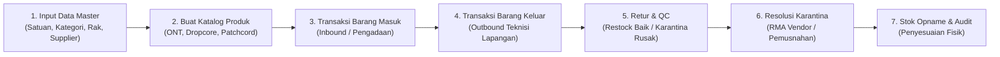

# Panduan Instalasi & Pengoperasian Sistem Inventaris Gudang ISP
## PT Gayuh Media Informatika (GMI)

Dokumen ini merupakan panduan lengkap langkah demi langkah (*step-by-step*) untuk menginstalasi, mengonfigurasi, dan menjalankan aplikasi **Sistem Informasi Inventaris & Logistik Gudang ISP** di lingkungan lokal maupun server produksi.

---

## 1. Prasyarat Sistem (Prerequisites)

Pastikan lingkungan server / perangkat Anda telah memenuhi spesifikasi berikut:

| Komponen | Versi Minimal | Keterangan |
| :--- | :--- | :--- |
| **PHP** | 8.2 atau lebih baru (Disarankan PHP 8.4) | Ekstensi wajib: `pdo_mysql`, `mbstring`, `bcmath`, `fileinfo`, `zip`, `openssl`, `curl` |
| **Composer** | 2.5 atau lebih baru | Package manager PHP |
| **Node.js & npm** | Node v18+ & npm v9+ | Diperlukan untuk kompilasi asset Tailwind & Alpine.js |
| **Database Engine** | MariaDB 10.6+ / 12+ atau MySQL 8.0+ | Port default proyek: `3307` (atau sesuaikan dengan database lokal Anda) |
| **Git** | Versi terbaru | Version control system |

Verifikasi kesiapan perangkat dengan perintah:
```bash
php -v
composer -V
node -v
npm -v
git --version
```

---

## 2. Langkah Instalasi Step-by-Step

### Langkah 1: Clone Repositori
Clone repositori ke direktori kerja Anda:
```bash
git clone https://github.com/garxpuji/stock-gudang.git
cd stock-gudang
```

### Langkah 2: Salin File Konfigurasi Environment (`.env`)
Salin template `.env.example` menjadi `.env`:

**Linux / macOS:**
```bash
cp .env.example .env
```

**Windows (PowerShell / Command Prompt):**
```powershell
copy .env.example .env
```

### Langkah 3: Konfigurasi Database di `.env`
Buka file `.env` dan sesuaikan koneksi database MariaDB / MySQL Anda:
```env
APP_NAME="Stock Gudang GMI"
APP_ENV=local
APP_DEBUG=true
APP_URL=http://localhost:8001

DB_CONNECTION=mariadb
DB_HOST=127.0.0.1
DB_PORT=3307
DB_DATABASE=stock_gudang
DB_USERNAME=root
DB_PASSWORD=
```
> [!TIP]
> - Jika instalasi MariaDB / MySQL Anda menggunakan port default `3306`, ubah `DB_PORT=3306`.
> - Pastikan database `stock_gudang` telah dibuat di server MariaDB/MySQL Anda:
>   ```sql
>   CREATE DATABASE IF NOT EXISTS stock_gudang CHARACTER SET utf8mb4 COLLATE utf8mb4_unicode_ci;
>   ```

### Langkah 4: Install Dependensi PHP via Composer
Jalankan instalasi dependensi backend:
```bash
composer install --no-interaction --prefer-dist --optimize-autoloader
```

### Langkah 5: Generate Application Key
Generate kunci enkripsi aplikasi Laravel:
```bash
php artisan key:generate
```

### Langkah 6: Install & Kompilasi Asset Frontend
Install dependensi JavaScript (Alpine.js, Tailwind CSS) dan lakukan bundling:
```bash
npm install
npm run build
```
> [!NOTE]
> Proyek ini menggunakan Alpine.js yang dibundel secara lokal mandiri (`resources/js/app.js`), sehingga aplikasi dapat berjalan sempurna di lingkungan intranet/offline tanpa ketergantungan CDN eksternal.

### Langkah 7: Jalankan Migrasi & Database Seeder
Jalankan migrasi skema tabel dan seeder kredensial akun pengguna:
```bash
php artisan migrate --seed
```
> [!IMPORTANT]
> Seeder default hanya memasukkan data akun pengguna (Superadmin & Admin Gudang) tanpa data dummy transaksi, sehingga aplikasi langsung siap digunakan dengan database bersih (*clean state*).

### Langkah 8: Buat Symbolic Link Storage
Pastikan direktori publik terhubung ke storage untuk upload bukti foto barang rusak:
```bash
php artisan storage:link
```

---

## 3. Menjalankan Server Aplikasi

Jalankan server aplikasi Laravel:
```bash
php artisan serve --port=8001
```
> [!NOTE]
> Kami menggunakan port `8001` (`http://127.0.0.1:8001`) untuk menghindari konflik dengan port `8000` yang sering digunakan oleh web server lain.

Buka browser dan akses:
👉 **[http://127.0.0.1:8001](http://127.0.0.1:8001)**

---

## 4. Kredensial Akun Default

Aplikasi dilengkapi dengan 3 akun pengguna bawaan hasil seeding:

| Email | Password | Role / Hak Akses | Nama Lengkap |
| :--- | :--- | :--- | :--- |
| `admin@gayuhmedia.id` | `password` | **Admin Gudang** | Budi Santoso |
| `tegar@gayuhmedia.id` | `password` | **Superadmin** | Tegar Pratama (Principal NOC) |
| `gudang@gayuhmedia.id` | `password` | **Admin Gudang** | Aris Munandar |

---

## 5. Alur Penggunaan Pertama Kali (Quick Start Guide)

Setelah login untuk pertama kali, ikuti urutan operasional berikut:



1. **Input Data Master** (Menu *Master Data*):
   - Tambah **Satuan** (Pcs, Meter, Roll, Unit, dll) di `/units`.
   - Tambah **Kategori** (ONT, Router, Kabel Dropcore, Pasif FO, dll) di `/categories`.
   - Tambah **Lokasi Rak** (RAK-A1, AREA-KABEL, LEMARI-TOOL, dll) di `/locations`.
   - Tambah **Supplier Vendor** (Fiberhome, ZTE, dll) di `/suppliers`.
2. **Katalog Produk & Material** (Menu *Produk*):
   - Daftarkan SKU barang, centang *Lacak Serial Number* jika berupa perangkat aktif (ONT, Router, AP).
3. **Barang Masuk / Inbound** (Menu *Barang Masuk*):
   - Catat penerimaan barang dari vendor.
   - Input Serial Number secara fleksibel (dipisahkan koma atau baris baru). Sistem otomatis membuat entri `ProductSerial` berstatus `AVAILABLE`.
4. **Barang Keluar / Outbound** (Menu *Barang Keluar*):
   - Alokasikan material ke teknisi lapangan (tiket PSB / Maintenance).
   - Cetak langsung **Surat Bukti Pengeluaran Barang (Surat Jalan)** fisik.
5. **Retur & QC** (Menu *Retur Barang*):
   - Terima pengembalian material dari teknisi.
   - Tetapkan hasil QC: unit **Baik** otomatis kembali ke stok aktif, unit **Rusak** otomatis masuk ke **Area Karantina**.
6. **Area Karantina & RMA** (Menu *Barang Rusak*):
   - Pantau barang rusak dan eksekusi tindakan: **Klaim Garansi (RMA) Vendor**, **Pemusnahan (Scrapped)** dengan kalkulasi nilai kerugian aset, atau **Perbaikan Internal**.
7. **Stok Opname & Kartu Stok** (Menu *Stok Opname* & *Mutasi Stok*):
   - Lakukan audit fisik periodik dan tinjau buku besar pergerakan barang secara terpadu.
8. **Kelola Pengguna** (Menu *Kelola User*):
   - Tambah akun staf gudang baru, perbarui password, dan kelola role.

---

## 6. Menjalankan Pengujian Otomatis (Testing Suite)

Untuk memvalidasi integritas seluruh fitur, modul, dan alur operasional:
```bash
php vendor/bin/phpunit
```
Seluruh 29 test case (197 assertions) mencakup:
- `UserControllerTest.php` (CRUD pengguna & validasi)
- `MasterDataTest.php` (CRUD Kategori, Satuan, Lokasi, Supplier)
- `EndToEndWorkflowTest.php` (Siklus penuh gudang ISP dari database kosong hingga cetak laporan)
- `HttpControllersTest.php` & `ActionsTest.php` (Unit controller & action transactions)

---

## 7. Pemecahan Masalah (Troubleshooting)

### Q: Port 8000 sudah digunakan aplikasi lain
**Solusi**: Jalankan aplikasi pada port lain (misal port 8001):
```bash
php artisan serve --port=8001
```

### Q: Tombol atau modal tidak merespon saat diklik
**Solusi**: Pastikan tidak ada residual file `public/hot` dan compile ulang asset:
```bash
if (Test-Path public\hot) { Remove-Item public\hot }
npm run build
```

### Q: Error Database Connection `SQLSTATE[HY000] [2002]`
**Solusi**: Pastikan service MariaDB / MySQL berjalan di komputer Anda, dan verifikasi nomor port pada file `.env` (`DB_PORT=3307` atau `3306`).

---

**Tim Pengembang & Logistik PT Gayuh Media Informatika**  
Sistem Informasi Gudang Terpadu & Infrastruktur Jaringan Optik
