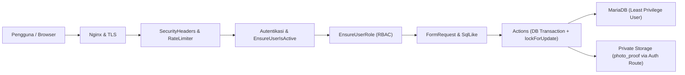

# Laporan Audit Keamanan Aplikasi — Stock Gudang GMI

- **Aplikasi**: Sistem Informasi Inventaris & Logistik Gudang ISP (PT Gayuh Media Informatika)
- **Stack Teknologi**: Laravel 13, PHP 8.4, MariaDB, Blade + Tailwind CSS + Alpine.js, PhpSpreadsheet, DomPDF
- **Tanggal Audit**: 25 November 2026
- **Status Remediasi**: **SELESAI DIPERBAIKI & TERVERIFIKASI** (Seluruh 8 temuan High, Medium, dan Low telah ditambal beserta unit/feature tests).
- **Metode & Standar Acuan**: *Defensive source-code & configuration audit* berpedoman pada [SKILL.md](file:///d:/project2/stock-gudang/cybersecurity/SKILL.md) dan referensi [patterns.md](file:///d:/project2/stock-gudang/cybersecurity/references/patterns.md), [sharps_edge.md](file:///d:/project2/stock-gudang/cybersecurity/references/sharps_edge.md), serta [validation.md](file:///d:/project2/stock-gudang/cybersecurity/references/validation.md).

---

## Ringkasan Eksekutif

Secara fondasi, aplikasi **Stock Gudang GMI** telah memiliki pertahanan dasar yang solid terhadap kerentanan klasik web (SQL Injection, XSS, CSRF, Mass Assignment, dan Excel Formula Injection), serta bebas dari kerentanan dependensi pihak ketiga berdasarkan pemindaian `composer audit` (**0 advisories**) dan `npm audit` (**0 vulnerabilities**).

Dalam audit berpedoman 7 prinsip utama pada [SKILL.md](file:///d:/project2/stock-gudang/cybersecurity/SKILL.md#L18-L25) (*Defense in Depth, Fail Secure, Least Privilege, Trust Nothing Outside Boundary, Security is a Process, Assume Breach, Simple Security*), teridentifikasi **8 temuan keamanan** (**3 High**, **4 Medium**, **1 Low**) yang kini telah **diperbaiki menyeluruh** di kode aplikasi, konfigurasi, maupun panduan deployment.

### Peta Arsitektur *Defense in Depth* (Setelah Remediasi)

---

## 1. Kontrol Keamanan yang Terverifikasi Aman

| Area Kontrol | Status | Bukti Verifikasi Kode & Konfigurasi |
| :--- | :---: | :--- |
| **SQL Injection & LIKE Wildcards** (`sql-injection` / `sec-sql-injection`) | **AMAN** | Seluruh kueri memakai Eloquent ORM & *parameter binding* (**0** `DB::raw`/`whereRaw`), dan seluruh pencarian `LIKE` di-escape lewat [SqlLike.php](file:///d:/project2/stock-gudang/app/Support/SqlLike.php). |
| **Cross-Site Scripting / XSS** (`xss-vulnerability` / `sec-xss-innerhtml`) | **AMAN** | Seluruh view Blade memakai auto-escaping `{{ ... }}` (**0** `{!! !!}`, `innerHTML`, `eval()`). Upload file diperketat ke `mimes:jpg,jpeg,png,webp` dan dilengkapi header `Content-Security-Policy` + `X-Content-Type-Options: nosniff` melalui [SecurityHeaders.php](file:///d:/project2/stock-gudang/app/Http/Middleware/SecurityHeaders.php). |
| **CSRF Protection** (`csrf-vulnerability` / `sec-no-csrf`) | **AMAN** | Semua form `POST` menyertakan `@csrf`, seluruh rute berada di middleware `web`, dan cookie sesi memakai `http_only = true`, `same_site = 'lax'`, serta `'encrypt' => true` di [config/session.php](file:///d:/project2/stock-gudang/config/session.php#L50). |
| **Otorisasi RBAC, `is_active`, & Mass Assignment** (`missing-authorization`) | **KUAT** | RBAC 3 tingkat ditegakkan di [EnsureUserRole.php](file:///d:/project2/stock-gudang/app/Http/Middleware/EnsureUserRole.php) & [routes/web.php](file:///d:/project2/stock-gudang/routes/web.php), pengecekan aktif akun berlaku menyeluruh termasuk `/dashboard` melalui [EnsureUserIsActive.php](file:///d:/project2/stock-gudang/app/Http/Middleware/EnsureUserIsActive.php), dan semua 17 model mendefinisikan `$fillable` eksplisit. |
| **Hashing Password & Keamanan Sesi** (`insecure-password-storage`) | **AMAN** | Password memakai Bcrypt 12 rounds + kebijakan `Password::min(10)->letters()->numbers()` & `max:128`, verifikasi `current_password` Superadmin, serta pemutusan sesi aktif + rotasi `remember_token` saat akun dinonaktifkan/diubah di [UserController.php](file:///d:/project2/stock-gudang/app/Http/Controllers/UserController.php). |
| **Integritas Transaksi & Formula Injection** | **AMAN** | Ekspor `.xlsx` di [ExportController.php](file:///d:/project2/stock-gudang/app/Http/Controllers/ExportController.php) menggunakan `DataType::TYPE_STRING`, sanitasi `'`, `setPreCalculateFormulas(false)`, dan batas maksimum 5.000 baris dengan `throttle:exports`. |
| **Riwayat Git & Audit Dependensi** | **BERSIH** | `.env` tidak pernah ter-commit di riwayat Git; `composer audit` dan `npm audit` melaporkan **0** kerentanan. |

---

## 2. Rekapitulasi Temuan & Status Perbaikan

### Prioritas Tinggi (*High*)

#### [HIGH-01] Kredensial Default Terbuka di `UserSeeder` & Risiko Reset Password Saat Deploy — **SELESAI**
- **Referensi**: [sharps_edge.md — `hardcoded-secret`](file:///d:/project2/stock-gudang/cybersecurity/references/sharps_edge.md#L3-L54), [patterns.md — *Secure by Default*](file:///d:/project2/stock-gudang/cybersecurity/references/patterns.md#L79-L99)
- **Lokasi**: [UserSeeder.php](file:///d:/project2/stock-gudang/database/seeders/UserSeeder.php), [DEPLOYMENT_LINUX.md](file:///d:/project2/stock-gudang/DEPLOYMENT_LINUX.md#L180-L187)
- **Implementasi Perbaikan**:
  - `UserSeeder` beralih dari `updateOrCreate` ke pemeriksaan eksistensi + `firstOrCreate` sehingga password akun eksisting tidak pernah tertimpa saat seeder dijalankan ulang.
  - Password awal pada non-lokal/non-testing kini membaca `INITIAL_ADMIN_PASSWORD` dari `.env` atau menghasilkan kata sandi acak `Str::password(16)` yang hanya ditampilkan di CLI seeder.
  - Panduan [DEPLOYMENT_LINUX.md](file:///d:/project2/stock-gudang/DEPLOYMENT_LINUX.md) memisahkan `migrate --force` dari seeding awal satu kali.

#### [HIGH-02] Kebocoran Detail Error Internal / SQL ke UI Produksi — **SELESAI**
- **Referensi**: [sharps_edge.md — `exposed-error-details`](file:///d:/project2/stock-gudang/cybersecurity/references/sharps_edge.md#L387-L436), [validation.md — `sec-exposed-stack`](file:///d:/project2/stock-gudang/cybersecurity/references/validation.md#L195-L212)
- **Lokasi**: [Controller.php](file:///d:/project2/stock-gudang/app/Http/Controllers/Controller.php), [StockInController.php](file:///d:/project2/stock-gudang/app/Http/Controllers/StockInController.php), [StockOutController.php](file:///d:/project2/stock-gudang/app/Http/Controllers/StockOutController.php), [ReturnController.php](file:///d:/project2/stock-gudang/app/Http/Controllers/ReturnController.php), [DamagedGoodController.php](file:///d:/project2/stock-gudang/app/Http/Controllers/DamagedGoodController.php), [StockOpnameController.php](file:///d:/project2/stock-gudang/app/Http/Controllers/StockOpnameController.php)
- **Implementasi Perbaikan**:
  - Menambahkan helper `handleTransactionException()` pada base [Controller.php](file:///d:/project2/stock-gudang/app/Http/Controllers/Controller.php) yang hanya meneruskan pesan *domain exception* (`InsufficientStockException`, `InvalidSerialException`, `\DomainException`) ke UI, mencatat exception lainnya ke `Log::error(...)`, dan menampilkan pesan generik yang aman ke pengguna.

#### [HIGH-03] Pencabutan Akses Akun Tidak Memutus Sesi Aktif & Bypass Cek `is_active` di Dashboard — **SELESAI**
- **Referensi**: [sharps_edge.md — `broken-session`](file:///d:/project2/stock-gudang/cybersecurity/references/sharps_edge.md#L340-L385), [patterns.md — *Session Security*](file:///d:/project2/stock-gudang/cybersecurity/references/patterns.md#L134-L168)
- **Lokasi**: [EnsureUserIsActive.php](file:///d:/project2/stock-gudang/app/Http/Middleware/EnsureUserIsActive.php), [routes/web.php](file:///d:/project2/stock-gudang/routes/web.php#L27), [UserController.php](file:///d:/project2/stock-gudang/app/Http/Controllers/UserController.php), [users/create.blade.php](file:///d:/project2/stock-gudang/resources/views/users/create.blade.php), [users/edit.blade.php](file:///d:/project2/stock-gudang/resources/views/users/edit.blade.php)
- **Implementasi Perbaikan**:
  - Menerapkan middleware `active` (`EnsureUserIsActive`) pada grup utama `['web', 'auth', 'active']` termasuk `/` dan `/dashboard`.
  - Menambahkan `revokeUserSessions()` di [UserController.php](file:///d:/project2/stock-gudang/app/Http/Controllers/UserController.php) untuk menghapus sesi target di tabel `sessions` dan merotasi `remember_token` setiap kali status aktif, peran, atau password diubah/dinonaktifkan.
  - Mewajibkan konfirmasi `current_password` Superadmin saat membuat pengguna baru atau mengubah peran/status/password pengguna.

---

### Prioritas Menengah (*Medium*)

#### [MEDIUM-01] Celah Bypass Validasi `redirect_to` via Prefix Subdomain — **SELESAI**
- **Referensi**: [sharps_edge.md — `unvalidated-redirect`](file:///d:/project2/stock-gudang/cybersecurity/references/sharps_edge.md#L534-L581), [validation.md — `sec-open-redirect`](file:///d:/project2/stock-gudang/cybersecurity/references/validation.md#L159-L176)
- **Lokasi**: [Controller.php](file:///d:/project2/stock-gudang/app/Http/Controllers/Controller.php), [CategoryController.php](file:///d:/project2/stock-gudang/app/Http/Controllers/CategoryController.php), [LocationController.php](file:///d:/project2/stock-gudang/app/Http/Controllers/LocationController.php), [UnitController.php](file:///d:/project2/stock-gudang/app/Http/Controllers/UnitController.php), [SupplierController.php](file:///d:/project2/stock-gudang/app/Http/Controllers/SupplierController.php), [products/create.blade.php](file:///d:/project2/stock-gudang/resources/views/products/create.blade.php)
- **Implementasi Perbaikan**: Mengganti pengecekan `str_starts_with(..., url('/'))` dengan metode `resolveSafeRedirect()` yang melakukan pencocokan eksak (*strict allowlist*) terhadap daftar rute internal terdaftar.

#### [MEDIUM-02] File Foto Bukti Kerusakan Tersimpan di Disk Publik Tanpa Autentikasi — **SELESAI**
- **Referensi**: [sharps_edge.md — `missing-authentication` Checklist](file:///d:/project2/stock-gudang/cybersecurity/references/sharps_edge.md#L181-L186), [patterns.md — *Secure by Default*](file:///d:/project2/stock-gudang/cybersecurity/references/patterns.md#L79-L99)
- **Lokasi**: [DamagedGoodController.php](file:///d:/project2/stock-gudang/app/Http/Controllers/DamagedGoodController.php), [ReturnController.php](file:///d:/project2/stock-gudang/app/Http/Controllers/ReturnController.php), [StoreDamagedGoodRequest.php](file:///d:/project2/stock-gudang/app/Http/Requests/StoreDamagedGoodRequest.php), [StoreReturnRequest.php](file:///d:/project2/stock-gudang/app/Http/Requests/StoreReturnRequest.php), [damaged_goods/show.blade.php](file:///d:/project2/stock-gudang/resources/views/damaged_goods/show.blade.php), [returns/show.blade.php](file:///d:/project2/stock-gudang/resources/views/returns/show.blade.php)
- **Implementasi Perbaikan**:
  - Memindahkan unggahan `photo_proof` ke disk privat `'local'` (`storage/app/private/damaged_proofs`), menyajikannya lewat endpoint terautentikasi `damaged-goods.photo` (`X-Content-Type-Options: nosniff`, `Cache-Control: private, no-store`), memperketat validasi ke `mimes:jpg,jpeg,png,webp`, serta menghapus file bila transaksi gagal (*no orphan files*).

#### [MEDIUM-03] Konfigurasi Cookie/Sesi, *HTTP Security Headers*, dan *Privilege* Database — **SELESAI**
- **Referensi**: [validation.md — `sec-insecure-cookie`](file:///d:/project2/stock-gudang/cybersecurity/references/validation.md#L141-L158), [patterns.md — *Secure by Default* & *Least Privilege*](file:///d:/project2/stock-gudang/cybersecurity/references/patterns.md#L25-L99)
- **Lokasi**: [SecurityHeaders.php](file:///d:/project2/stock-gudang/app/Http/Middleware/SecurityHeaders.php), [bootstrap/app.php](file:///d:/project2/stock-gudang/bootstrap/app.php), [config/session.php](file:///d:/project2/stock-gudang/config/session.php), [.env.example](file:///d:/project2/stock-gudang/.env.example), [DEPLOYMENT_LINUX.md](file:///d:/project2/stock-gudang/DEPLOYMENT_LINUX.md)
- **Implementasi Perbaikan**:
  - Mengaktifkan enkripsi sesi default (`SESSION_ENCRYPT=true`), mendokumentasikan `SESSION_SECURE_COOKIE` pada `.env.example` dan `DEPLOYMENT_LINUX.md`, memasang middleware global `SecurityHeaders`, menghapus `X-XSS-Protection` usang di contoh Nginx, serta mempersempit hak akses user MariaDB (*Least Privilege*, tanpa `DROP`/`GRANT OPTION`).

#### [MEDIUM-04] Rate Limit Login Hanya per-IP & Ekspor Laporan Tanpa Batas Baris / Throttle — **SELESAI**
- **Referensi**: [patterns.md — *Defense in Depth*](file:///d:/project2/stock-gudang/cybersecurity/references/patterns.md#L7-L22)
- **Lokasi**: [AppServiceProvider.php](file:///d:/project2/stock-gudang/app/Providers/AppServiceProvider.php), [routes/web.php](file:///d:/project2/stock-gudang/routes/web.php), [ExportController.php](file:///d:/project2/stock-gudang/app/Http/Controllers/ExportController.php)
- **Implementasi Perbaikan**:
  - Menambahkan `RateLimiter::for('login', ...)` dengan kunci `email|ip` (`5/menit`) plus batas fallback per-IP (`20/menit`).
  - Menambahkan `RateLimiter::for('exports', ...)` (`10/menit`), memasang `limit(5000)` di semua metode ekspor, serta mencatat event audit `security.report_exported`.

---

### Prioritas Rendah (*Low*)

#### [LOW-01] Penguatan Kebijakan Password, Audit Log Keamanan, `robots.txt`, & Escape Wildcard `LIKE` — **SELESAI**
- **Referensi**: [patterns.md — *Input Validation Boundary*, *Logging Sensitive Data*](file:///d:/project2/stock-gudang/cybersecurity/references/patterns.md#L50-L221)
- **Lokasi**: [UserController.php](file:///d:/project2/stock-gudang/app/Http/Controllers/UserController.php), [AuthController.php](file:///d:/project2/stock-gudang/app/Http/Controllers/AuthController.php), [SqlLike.php](file:///d:/project2/stock-gudang/app/Support/SqlLike.php), [Product.php](file:///d:/project2/stock-gudang/app/Models/Product.php), [StockMutation.php](file:///d:/project2/stock-gudang/app/Models/StockMutation.php), [public/robots.txt](file:///d:/project2/stock-gudang/public/robots.txt)
- **Implementasi Perbaikan**:
  - Kebijakan password ditingkatkan menjadi `Password::min(10)->letters()->numbers()` + `max:128`.
  - Pencatatan audit log keamanan ditambahkan untuk kejadian login berhasil/gagal, logout, pembuatan/perubahan/penonaktifan/penghapusan akun, dan ekspor laporan (tanpa menyertakan kredensial).
  - `public/robots.txt` diubah menjadi `Disallow: /` beserta header `X-Robots-Tag: noindex, nofollow`.
  - Seluruh kueri pencarian `LIKE` di model & controller kini memakai `SqlLike::contains()`.

---

## 3. Status Rencana Remediasi & Pengujian

1. **Gelombang 1 (Prioritas Tinggi — Selesai)**
   - [x] Perbaiki [UserSeeder.php](file:///d:/project2/stock-gudang/database/seeders/UserSeeder.php) (`firstOrCreate` + `INITIAL_ADMIN_PASSWORD` / acak) dan panduan [DEPLOYMENT_LINUX.md](file:///d:/project2/stock-gudang/DEPLOYMENT_LINUX.md).
   - [x] Persempit blok `catch` pada 5 controller transaksi melalui `handleTransactionException()` agar tidak membocorkan error SQL ke UI.
   - [x] Terapkan middleware `EnsureUserIsActive` pada seluruh rute `auth` termasuk `/dashboard`, hapus sesi + rotasi `remember_token` saat pencabutan akses, dan wajibkan `current_password` Superadmin.
2. **Gelombang 2 (Prioritas Menengah — Selesai)**
   - [x] Ganti validasi `redirect_to` dengan whitelist rute internal `resolveSafeRedirect()`.
   - [x] Pindahkan `photo_proof` ke disk privat `'local'`, sajikan lewat rute berautentikasi, perketat `mimes:jpg,jpeg,png,webp`, dan bersihkan *orphan file* saat transaksi gagal.
   - [x] Aktifkan `SESSION_ENCRYPT=true`, dokumentasikan `SESSION_SECURE_COOKIE`, tambahkan middleware `SecurityHeaders`, dan terapkan *Least Privilege* MariaDB.
   - [x] Gunakan `RateLimiter` `email|ip` untuk login dan `throttle:exports` + batas 5.000 baris di `ExportController`.
3. **Gelombang 3 (Prioritas Rendah & Verifikasi — Selesai)**
   - [x] Terapkan kebijakan password `min:10` huruf+angka & `max:128`, security audit logging, `Disallow: /` di `robots.txt`, serta escape wildcard `LIKE`.
   - [x] Tambahkan pengujian otomatis di [SecurityHardeningTest.php](file:///d:/project2/stock-gudang/tests/Feature/SecurityHardeningTest.php) dan perbarui [UserControllerTest.php](file:///d:/project2/stock-gudang/tests/Feature/UserControllerTest.php).

---

> **Catatan Administratif Skill `cybersecurity`**: Di dalam [SKILL.md](file:///d:/project2/stock-gudang/cybersecurity/SKILL.md#L33-L34) tertulis nama file referensi `references/sharp_edges.md` dan `references/validations.md`, sedangkan file aktual di disk bernama [sharps_edge.md](file:///d:/project2/stock-gudang/cybersecurity/references/sharps_edge.md) dan [validation.md](file:///d:/project2/stock-gudang/cybersecurity/references/validation.md). Seluruh isi ketiga file referensi telah ditelaah penuh sebagai dasar audit dan remediasi ini.
